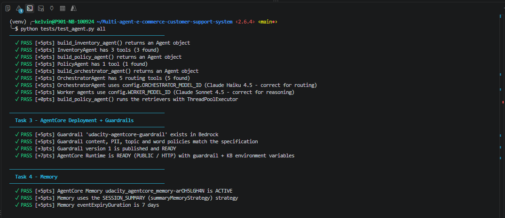
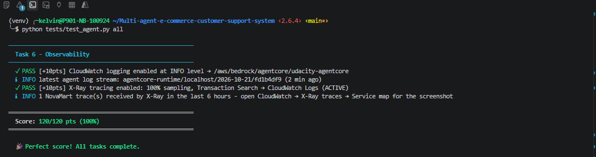
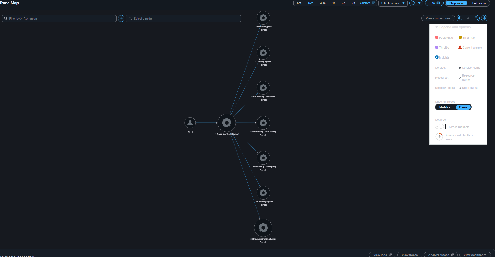
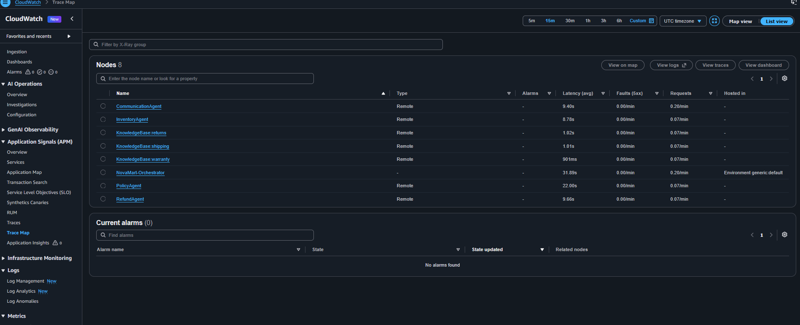
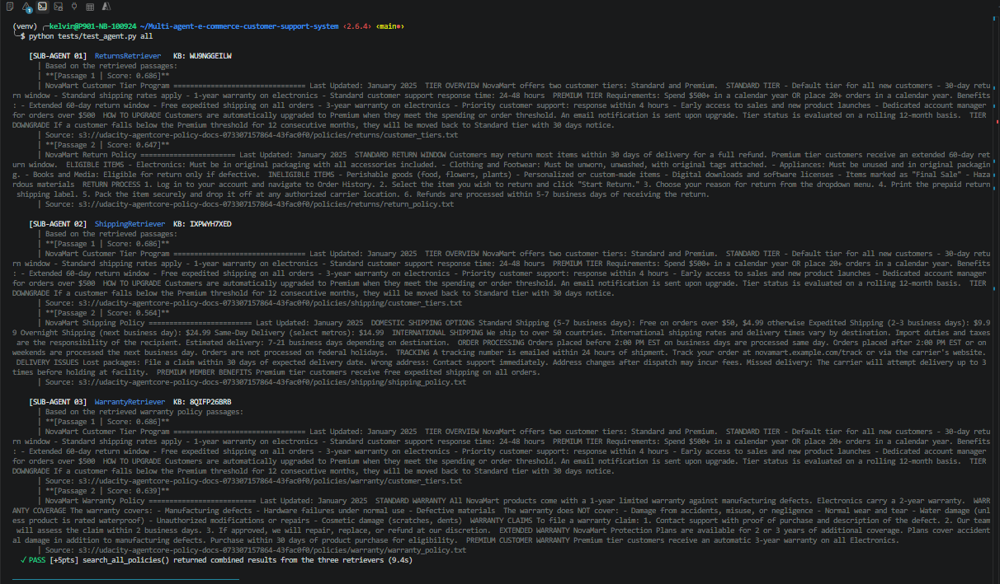
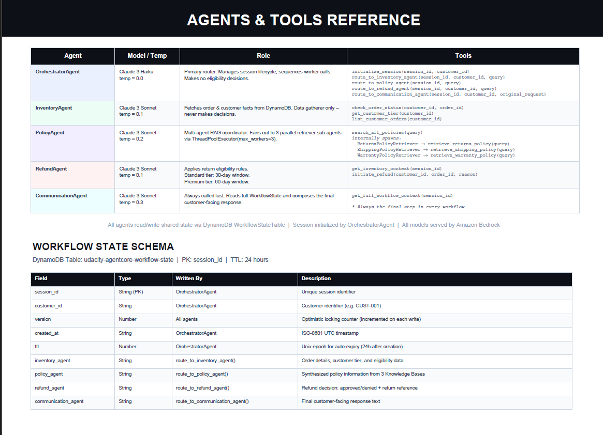
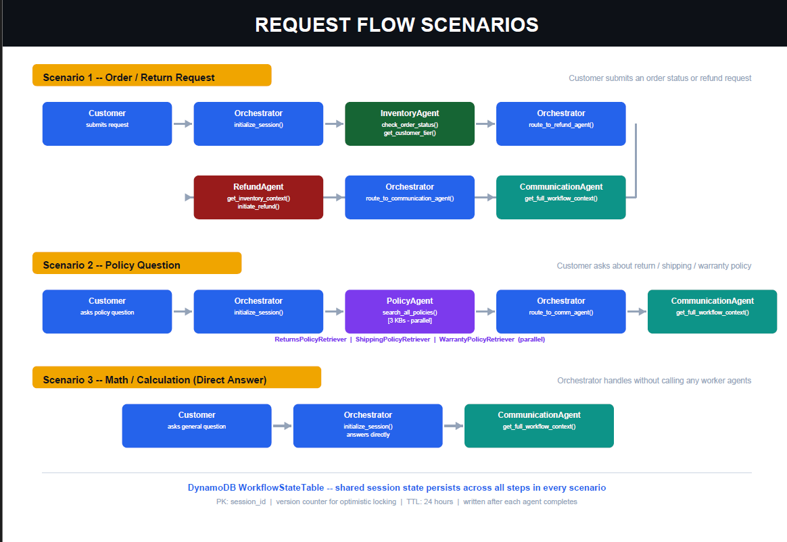

# NovaMart: Multi-Agent Customer Support on Amazon Bedrock AgentCore

A deployed multi-agent customer support system for a fictional retailer. An orchestrator routes each request to specialist agents for orders, policy and refunds. Three knowledge bases are searched in parallel to ground answers in policy text, a guardrail filters unsafe content, and every request is traced end to end in AWS X-Ray.


**Stack:** Python 3.12 · Strands Agents SDK · Amazon Bedrock AgentCore (Runtime, Memory) · Claude Haiku 4.5 / Sonnet 4.5 · Bedrock Knowledge Bases on S3 Vectors · Bedrock Guardrails · DynamoDB · AWS CDK (via AgentCore CLI) · CloudWatch + X-Ray

> Built on the Udacity AgentCore capstone scaffold; I implemented the agent layer, guardrail, deployment, memory and observability. The original course instructions are in [Udacity/TODOs](Udacity/TODOs).


---

## Results

All 120/120 checks in the automated suite pass against live AWS resources: agent graph, guardrail, deployed runtime, memory, knowledge bases and observability.

| | |
|---|---|
|  |  |
| Agent graph, guardrail, runtime and memory checks | Observability checks and final score |

**One request traced end to end in X-Ray.** The orchestrator fans out to the worker agents, and each knowledge base call shows up as its own node:





**Parallel RAG.** The PolicyAgent sends three retriever sub-agents to the returns, shipping and warranty knowledge bases at the same time:



### Example routing

| Request | Route |
|---|---|
| "I want to return my order ORD-27176" (CUST-001) | Orchestrator → Inventory → Refund → Communication |
| "What is the return policy for premium customers?" | Orchestrator → Policy (3 parallel KB retrievers) → Communication |
| "How much are 5 items at $29.99 with 10% off?" | Orchestrator → Communication (no data or policy lookup needed) |

---

## Architecture

```
Customer Request
      │
OrchestratorAgent (Claude Haiku 4.5 - routes requests, manages WorkflowState)
      │
   ┌──┼──────────────────────────┬──────────────────┐
   │  │                          │                  │
InventoryAgent    PolicyAgent    RefundAgent    CommunicationAgent
(DynamoDB)     (Multi-Agent RAG)  (DynamoDB)     (synthesizes response)
                     │
         ┌───────────┼───────────┐
    ReturnsPolicyRetriever  ShippingPolicyRetriever  WarrantyPolicyRetriever
    (Bedrock KB)          (Bedrock KB)              (Bedrock KB)
         └───────── run in PARALLEL ───────────┘

Shared State: DynamoDB WorkflowStateTable (with optimistic locking)
```

### Agent roles

| Agent | Model | Responsibility | Tools |
|-------|-------|-----------------|-------|
| **OrchestratorAgent** | Claude Haiku 4.5 | Routes requests, creates/updates WorkflowState | `initialize_session`, `route_to_inventory_agent`, `route_to_policy_agent`, `route_to_refund_agent`, `route_to_communication_agent` |
| **InventoryAgent** | Claude Sonnet 4.5 | Gathers order and customer facts from DynamoDB | `check_order_status`, `get_customer_tier`, `list_customer_orders` |
| **PolicyAgent** | Claude Sonnet 4.5 | Coordinates parallel RAG retrieval from 3 KBs | `search_all_policies` (fans out to 3 retriever sub-agents) |
| **RefundAgent** | Claude Sonnet 4.5 | Decides return/refund eligibility (30-day Standard, 60-day Premium) | `get_inventory_context`, `initiate_refund` |
| **CommunicationAgent** | Claude Sonnet 4.5 | Drafts the final, customer-facing reply | `get_full_workflow_context` |





---

## What I built and why

All of this is in [src/agent_orchestrator.py](src/agent_orchestrator.py).

- **Orchestrator → workers graph.** Five Strands agents. The router runs on Claude Haiku 4.5 at temperature 0.0 because routing has to be fast, cheap and predictable. The workers run on Sonnet 4.5 at temperatures 0.1–0.3 because their tasks need more reasoning.
- **Explicit routing rules.** Each request opens a session first. Order and refund requests go Inventory → Refund. Policy questions go to the PolicyAgent. Account questions ("am I premium?") go to Inventory, never to Policy, because the policy KBs know nothing about customers. Arithmetic skips the data agents entirely. The orchestrator never writes the reply itself: the CommunicationAgent always does, so tone and formatting stay consistent.
- **Parallel multi-agent RAG.** `search_all_policies` runs three retriever sub-agents in a `ThreadPoolExecutor(max_workers=3)` and combines their passages by domain. Each retriever resets its message history per query so requests don't bleed into each other. A failing knowledge base returns an error marker instead of failing the whole answer.
- **Shared state with optimistic locking.** Agents exchange results through a DynamoDB `WorkflowStateTable`. Writes are conditional on a `version` attribute and retry on conflict, so concurrent updates can't silently overwrite each other.
- **Guardrail tuning.** The Bedrock guardrail has content filters (HIGH for sexual, violence and hate; MEDIUM for insults and misconduct), blocks card numbers and SSNs, anonymises emails and phone numbers, and filters profanity. Three topics are denied: competitor products, pricing negotiations and legal threats. They run on the STANDARD tier with a cross-region profile. With looser topic definitions, "5 items at $29.99 with 10% off" was blocked as a pricing negotiation. I narrowed the definition to haggling or changing an advertised price, with example phrases. The guardrail is published as a numbered version, not `DRAFT`.
- **Deployment.** One command builds the agents, creates the guardrail, stages the code and deploys it to AgentCore Runtime through the AgentCore CLI (CDK under the hood). The runtime has no guardrail parameter, so the guardrail ID and version are passed as environment variables and applied to every `BedrockModel` call.
- **Memory.** AgentCore Memory with the `SESSION_SUMMARY` strategy and 7-day event expiry, so customers don't have to repeat themselves between turns.
- **Observability.** CloudWatch logs at INFO level, plus X-Ray tracing through CloudWatch Transaction Search. Sampling is 100% in dev and about 5% is intended for production. Every `route_to_*` call and knowledge base retrieval appears as a node in the trace.

---

## Quick start

### Prerequisites

- Python 3.12 (matches the deployed runtime)
- AWS account with Bedrock access in `us-east-1`
- IAM permissions for Bedrock, Bedrock AgentCore, DynamoDB, S3, S3 Vectors, CloudFormation, CloudWatch and X-Ray. The AgentCore CLI deploys through AWS CDK, so `cloudformation:*`, `iam:PassRole` and the CDK bootstrap roles are needed too.
- **AgentCore CLI** ([`@aws/agentcore`](https://github.com/aws/agentcore-cli)), which needs **Node.js 20+** and [**uv**](https://docs.astral.sh/uv/getting-started/installation/):

  ```bash
  npm install -g @aws/agentcore@0.30.0
  agentcore --version
  ```

  > The CLI replaces the older Python `bedrock-agentcore-starter-toolkit`. Both install an `agentcore` command, so uninstall the old one if you have it: `pip uninstall bedrock-agentcore-starter-toolkit`.

### 1. Install and configure

```bash
pip install -r requirements.txt
cp .env.example .env
python config.py        # prints every resolved resource name
```

### 2. Provision the base infrastructure

Deploy [infrastructure/starter_stack.yaml](infrastructure/starter_stack.yaml) once (stack name `udacity-agentcore`, region `us-east-1`, `CAPABILITY_NAMED_IAM`). It creates the DynamoDB tables, the policy-docs S3 bucket, an S3 Vectors bucket with three indexes, the AgentCore execution role and the log group. Then seed the data:

```bash
python infrastructure/seed_data.py
```

This loads four mock customers (`CUST-001` … `CUST-004`) with deterministic orders (e.g. `ORD-27176`) and sample returns, shipping and warranty policies.

### 3. Create the knowledge bases

Create three self-managed Bedrock Knowledge Bases in the console. Use the existing S3 Vectors store; don't pick *Quick create*. Run `python config.py` to get the bucket names.

| Setting | Returns KB | Shipping KB | Warranty KB |
|---|---|---|---|
| S3 prefix | `policies/returns/` | `policies/shipping/` | `policies/warranty/` |
| Embedding model | `amazon.titan-embed-text-v2:0` | same | same |
| Vector index | `returns-policy-index` | `shipping-policy-index` | `warranty-policy-index` |

Sync each data source, then put the IDs in `.env` (`RETURNS_KB_ID`, `SHIPPING_KB_ID`, `WARRANTY_KB_ID`).

### 4. Deploy

```bash
python src/agent_orchestrator.py deploy
```

| Step | What it does |
|------|-------------|
| 1/6 | Build the 5-agent graph locally |
| 2/6 | Create and version the Bedrock Guardrail |
| 3/6 | Stage code in `build/runtime/`, write `agentcore/agentcore.json`, run `agentcore deploy -y` |
| 4/6 | Create AgentCore Memory |
| 5/6 | Configure observability (CloudWatch + X-Ray Transaction Search) and redeploy the runtime env vars |
| 6/6 | Optional AgentCore Gateway (skipped unless Lambda tool functions are configured) |

The first run bootstraps CDK, so allow 5–10 minutes. Re-running is safe. Copy the printed `AGENTCORE_RUNTIME_ARN`, `GUARDRAIL_ID` and `GUARDRAIL_VERSION` into `.env`.

### 5. Run it

```bash
python src/agent_orchestrator.py test     # 3 end-to-end scenarios, prints X-Ray trace IDs
python src/agent_orchestrator.py chat     # interactive session with colour-coded agent trace

# Against the deployed runtime
python src/agent_orchestrator.py invoke "What is the return policy for premium customers?" CUST-002
agentcore invoke '{"prompt": "I want to return my order ORD-27176", "customer_id": "CUST-001"}'
agentcore status
agentcore logs
```

### 6. Test

```bash
python tests/test_agent.py all
```

### 7. Clean up

```bash
python infrastructure/cleanup.py          # dry run
python infrastructure/cleanup.py --yes    # delete everything the project created
```

This removes the knowledge bases, the AgentCore stack (runtime and memory), the guardrail, the CloudFormation stack and the log groups. Some deletions are asynchronous, so run it twice. Add `--disable-transaction-search` to switch Transaction Search off.

---

## Project structure

```
.
├── config.py                      # Central configuration (CloudFormation exports + env vars)
├── requirements.txt
├── .env.example
├── agentcore/                     # AgentCore CLI project (runtime definition + CDK app)
│   ├── agentcore.json
│   ├── aws-targets.json
│   └── cdk/
├── src/
│   ├── agent_orchestrator.py      # Agents, tools, guardrail, deploy, memory, observability (my implementation)
│   ├── agent_observability.py     # X-Ray / CloudWatch tracing helpers (provided scaffold)
│   ├── agent_utils.py             # Terminal trace UI (provided scaffold)
│   ├── agentcore_cli.py           # AgentCore CLI wrapper (provided scaffold)
│   ├── bedrock_kb_retrieval.py    # KB retrieval helper (provided scaffold)
│   └── demo.py                    # Demo script (provided scaffold)
├── infrastructure/
│   ├── starter_stack.yaml         # CloudFormation: DynamoDB, S3, S3 Vectors, IAM, CloudWatch
│   ├── seed_data.py
│   └── cleanup.py
├── tests/test_agent.py            # Automated test suite (120 checks)
├── diagrams/                      # Architecture diagrams
├── screenshots/                   # Test and X-Ray evidence
└── Udacity/TODOs                  # Original course instructions
```

---

## Configuration

Most resource names (tables, buckets, role, log group) load automatically from the CloudFormation exports. `.env` holds the rest:

```bash
AWS_REGION=us-east-1
PROJECT_NAME=udacity-agentcore

RETURNS_KB_ID=
SHIPPING_KB_ID=
WARRANTY_KB_ID=

AGENTCORE_RUNTIME_ARN=      # printed by the deploy command
GUARDRAIL_ID=               # printed by the deploy command
GUARDRAIL_VERSION=          # a number, not DRAFT
```

---

## Troubleshooting

**Config values missing?** Run `python config.py`. Tables, buckets, role and log group come only from the `udacity-agentcore` stack exports, so check that the stack is `CREATE_COMPLETE` in `us-east-1`. KB IDs, the runtime ARN and the guardrail values come from `.env`.

**X-Ray traces not appearing?** Each `test`/`chat`/`demo` run prints `X-Ray trace <id> published`. If it says *not published*, the warning above it names the cause, usually a missing `xray:PutTraceSegments` permission or `AGENT_TRACING_ENABLED=false`. In the console, pick "Last 5 minutes" and allow up to 60 seconds.

**`check_order_status` fails with "The provided key element does not match the schema"?** The Orders table key is `customer_id` + `order_id`, so both must be passed to `get_item`.

**`agentcore: command not found`?** Install Node.js 20+ and `npm install -g @aws/agentcore@0.30.0`. If `agentcore` prints toolkit-style help (`configure`, `launch`), that's the old Python toolkit: run `pip uninstall bedrock-agentcore-starter-toolkit`.

**`agentcore deploy` fails while packaging?** The CLI uses `uv` to fetch arm64 / Python 3.12 wheels, so it needs `uv` on PATH and internet access. `python src/agentcore_cli.py` shows what the wrapper sees, and `agentcore/.cli/logs/` has the CLI log.

**`agentcore deploy` fails with a CDK / CloudFormation error?** Check the `AgentCore-udacity-default` stack in the CloudFormation console for the failing resource, fix the cause and re-run the deploy.

---

## Resources

- [Strands Agents SDK](https://github.com/strands-agents/sdk-python)
- [Amazon Bedrock AgentCore](https://docs.aws.amazon.com/bedrock-agentcore/latest/devguide/)
- [AgentCore CLI](https://github.com/aws/agentcore-cli)
- [Bedrock Knowledge Bases](https://docs.aws.amazon.com/bedrock/latest/userguide/knowledge-base.html)
- [Bedrock Guardrails](https://docs.aws.amazon.com/bedrock/latest/userguide/guardrails-create.html) · [safeguard tiers](https://docs.aws.amazon.com/bedrock/latest/userguide/guardrails-tiers.html)
